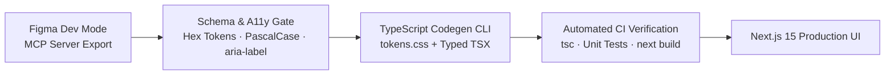

# Figma Dev Mode + MCP Design-to-Code Kit

[](https://github.com/mabdullah-ml/figma-mcp-design-to-code-kit/actions/workflows/ci.yml)
[](./LICENSE)
[](#)
[](#)

> 🌐 **[日本語ドキュメントはこちら (README.ja.md)](./README.ja.md)**

An automated **Figma Dev Mode + Model Context Protocol (MCP) design-to-code pipeline** that validates design tokens and accessibility metadata, generates strongly-typed **React / Next.js 15 + Tailwind CSS** components, and verifies every generated artifact in CI via `tsc --noEmit`, unit tests, and `next build`.

---

## Workflow



## Quick Start

```bash
npm install
npm run codegen      # Generate typed TSX components + CSS tokens from samples/figma_mcp_export.json
npm run typecheck    # Strict TypeScript check
npm test             # Verify codegen & accessibility guardrails
npm run build        # Verify Next.js production build
```

## Author

**Abdullah Mamun, Ph.D.** — Senior Generative AI / LLM Engineer · Forward-Deployed AI Engineer · PMP  
[GitHub](https://github.com/mabdullah-ml) · [LinkedIn](https://www.linkedin.com/in/mamunabdullah01)
